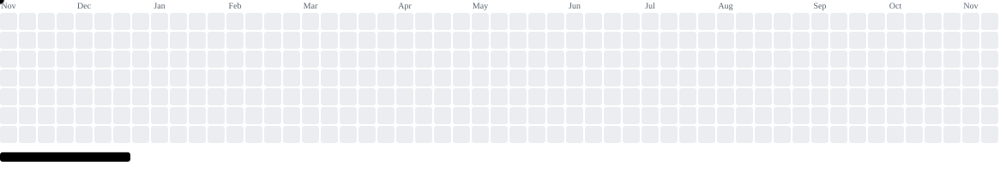

 

  

###

<h1 data-importer="text" align="left">Hey 👋🏽</h1>

###

<picture data-importer="pacman">
  <source media="(prefers-color-scheme: dark)" srcset="https://raw.githubusercontent.com/Luccascosta-dev/Luccascosta-dev/pacman-output/breakout-contribution-graph-dark.svg?game=breakout">
  <source media="(prefers-color-scheme: light)" srcset="https://raw.githubusercontent.com/Luccascosta-dev/Luccascosta-dev/pacman-output/breakout-contribution-graph.svg?game=breakout">
  
</picture>

###

<h5 data-importer="text" align="left">Print ("hello world")</h5>

###

<h2 data-importer="text" align="left">📚​ Conhecimentos</h2>

###

 

<h5 data-importer="text" align="left">Sistemas Operacionais: Experiência avançada em Linux e servidores  Containers & Engenharia: Criação e gerenciamento de ambientes isolados utilizando Docker.  Desenvolvimento Web: Criação de aplicações modernas, responsivas e seguras.  Segurança Cibernética: Aplicação de boas práticas de segurança defensiva, análise de vulnerabilidades e hardening de sistemas.</h5>

###

<h2 data-importer="text" align="left">Technologies & Tools</h2>

###

  
  
  
  
  
  
  
  
  
  
  
  
  
  
  
  
  
  
  
  
  

###

  

###

 

  

###
